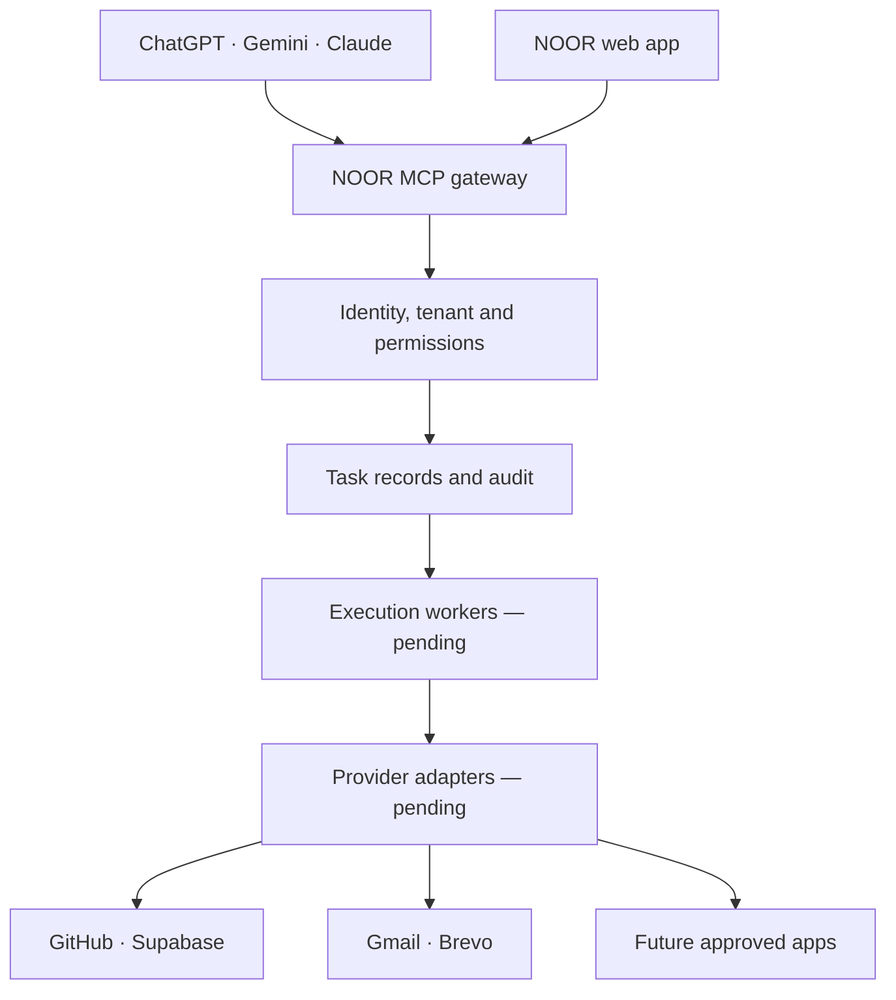

# NOOR backend and central integration gateway

## Deployed on 4 November 2026

Only destination project `ayrryemawwplguaauxij` was modified. No historical school data was imported or deleted. No provider messages were sent and no external account was connected.

Three new migrations add canonical `institution_id` backend workflows and fix missing API grants. They do **not** make the old `school_id` frontend compatible automatically.

| Capability | Backend state | Frontend / account dependency |
|---|---|---|
| School/university onboarding | Immediate principal membership; serialised per user; audited | Existing v2 onboarding calls the same RPC |
| Teacher/student joining codes | Separate hashed codes, 30-day expiry, rotation, no suspended-member rejoin | Connect forms to RPCs below |
| Pause/reactivate | Leadership-only, tenant-scoped, audited; student/teacher data requires active membership | Connect management buttons to the new RPC |
| Classes/sections and profile editing | Missing Data API grants repaired; existing RLS retained | Existing v2 workspace can now write supported fields |
| Attendance | Atomic batches, enrolled students only, assigned teacher/leadership checks, immutable identity, audit | Wire attendance screen to `noor_submit_attendance` |
| Smart notes, revision, recorded lessons, assignments | `noor_learning_items`, draft/published visibility and group scope | Existing legacy modules still need porting |
| Assignment submissions | Own enrolled students, published assignments, deadline checks | Wire student submission form |
| Marks and feedback | `noor_assessment_results`, enrolled student validation; own-student read | Wire progress screens and PDF export |
| Notices/meetings/exams/events | `noor_calendar_events`, institution/group scope | Wire existing calendar widgets |
| Learning file storage | Private `noor-learning-files`, author UUID paths, reads through visible learning items; 50 MB/object | Actual file upload/download testing with signed-in accounts pending |
| Provider registry | `noor_connections`, metadata only, disabled by default | Registration is not OAuth authorization |
| Central task storage | `noor_workflow_jobs`, durable drafts, idempotency, immutable audit | No execution worker, approvals, retries or outbound sending yet |
| Internal MCP | Deployed gateway `/mcp`, user-JWT auth, three bounded tools | External OAuth discovery/consent/client revocation pending |

## Recommended architecture



The AI proposes tool calls. The gateway authenticates each caller and institution before any operation. A model never becomes an administrator or gains provider credentials. A NOOR customer-facing gateway must not expose Supabase administration SQL or a GitHub owner's broad access token to school users.

GitHub's official MCP is for repository work. NOOR's MCP is for authorised school workflows. They can coexist. PR #24 remains a separate older read-only MCP foundation; this deployment does not merge it or claim it is already live.

### Service connections still required

- OpenAI, Gemini and Anthropic: server-side API credentials, model selection and per-institution usage budgets. Consumer chat sessions are not imported into this gateway.
- GitHub: an installation-scoped GitHub App for selected repositories. Verify the actual Enterprise host and SSO policy before configuring Enterprise access.
- Supabase: user-JWT database access is deployed. Database administration remains outside customer tool access.
- Gmail: per-account Google OAuth consent, minimum scopes, verified redirect URL, encrypted refresh tokens, revocation and recipient checks. No Gmail account has been connected by this work.
- Brevo: server-side API key, verified sender and delivery webhooks. No messages were sent.
- Future apps: reviewed adapter manifest, allowed tools/scopes, fixed trusted endpoints and tests. Do not accept arbitrary client-provided URLs or executable code.

Use Supabase Secrets for platform provider keys. For customer-specific OAuth tokens, implement an encrypted token store with server-only access; never put tokens in `noor_connections`, task payloads, public tables, browser storage or GitHub. Token storage/OAuth is not yet implemented.

## Gateway API

Endpoint:

`https://ayrryemawwplguaauxij.supabase.co/functions/v1/noor-backend-api`

POST JSON with `Authorization: Bearer <current NOOR access token>` and the project's public `apikey` header. JWT verification remains enabled. Browser origin is restricted to `https://noormanagement43.github.io`. Native clients without an Origin header still authenticate.

```js
const response = await supabase.functions.invoke('noor-backend-api', {
  body: { action: 'status' }
});
```

| action | Extra fields | Permission |
|---|---|---|
| `status` | none | Signed-in user; booleans only, no key values |
| `join` | `institution_id`, `code` | Signed-in user with valid role-specific code |
| `connections.register` | `institution_id`, `provider`, `label` | Active institution leadership |
| `connections.list` | `institution_id`, optional `cursor` | Active institution leadership |
| `tasks.draft` | `institution_id`, `connection_id`, `operation`, `payload`, `idempotency_key` | Active institution leadership |
| `tasks.list` | `institution_id`, optional `cursor` | Active institution leadership |
| `members.status` | `institution_id`, `membership_id`, `status` (`active` / `suspended`) | Active institution leadership; no self-suspension |
| `join_codes.rotate` | `institution_id`, `role` (`teacher` / `student`) | Active institution leadership; code returned once |

Task operations are currently `ai.generate`, `github.read`, `gmail.draft`, `brevo.draft` and `supabase.report`; **all only save drafts**. Provider/operation combinations are checked in Postgres. Reusing the same idempotency key with changed input is rejected. Registrations remain disabled and no execution transition is exposed.

List responses contain up to 50 rows and a timestamp/UUID `next_cursor`. The request limit is 24 KiB; stored task payloads are capped at 16 KiB. Successful draft creation and connector changes use shared database counters. This is not a complete edge/IP abuse prevention service; invalid transactions roll back their counters.

### Academic RPCs

```js
await supabase.rpc('noor_set_member_status', {
  p_institution: institutionId, p_membership: membershipId, p_status: 'suspended'
});
await supabase.rpc('noor_rotate_join_code', {
  p_institution: institutionId, p_role: 'teacher'
});
await supabase.rpc('noor_join_institution', {
  p_institution: institutionId, p_code: joiningCode
});
await supabase.rpc('noor_submit_attendance', {
  p_session: sessionId,
  p_records: [{ student_membership_id: studentMembershipId, status: 'present' }]
});
```

New learning/grade/calendar tables can be queried through Supabase under RLS. Teachers must first have a verified active `academic_group_memberships` assignment from leadership. A self-created timetable period alone does not grant grading or learning-material authority. Submissions are append-only; editing/reopening submissions is a future reviewed workflow.

## Internal MCP handover

Endpoint: append `/mcp` to the gateway URL.

Transport: stateless Streamable HTTP, JSON-RPC, user-JWT authentication. Supported tools:

- `noor_list_connections`
- `noor_list_task_drafts`
- `noor_draft_task`

Protocol versions: `2025-11-25`, `2025-06-18`, `2025-03-26`.

This internal endpoint is **not ready to advertise as a customer ChatGPT/Gemini/Claude connection**. Missing OAuth 2.1 discovery/PKCE/consent, client-scoped revocation, live MCP client testing and execution workers must be completed first. Do not paste a long-lived NOOR user JWT into a public connector configuration.

## Scale target and validation

20 institutions × 5,000 students = 100,000 student records, before staff/parents. This is a sizing target, not a capacity guarantee. Peak concurrency, attendance bursts, report workloads, upload sizes, uptime and recovery targets still need measuring.

Implemented: tenant/group composite foreign keys, row security, foreign-key indexes, timestamp/UUID pagination, bounded request bodies and batches, durable idempotent task drafts, append-only application audit, atomic attendance and row ownership guards.

Still required: production compute sizing, connection pooling for any direct Postgres worker, background job leases/retries/dead letters, provider quotas, webhook verification/deduplication, external OAuth, secret rotation, observability/alerts, backup restoration drills and a representative 100,000-student load test. Real-user browser tests for every existing dashboard remain pending. Existing legacy root modules are not fully migrated to the canonical new tables.

### Verified in this change

- 74 existing Node regression tests passed.
- Deno gateway type check and 3 HTTP/auth/stream-size/secret-redaction/MCP boundary tests passed.
- Database integration tests ran under `authenticated` roles in a rolled-back transaction: tenant isolation, unassigned teacher denial, own-student grades, student write denial, assignment submission, attendance atomicity, task idempotency/conflict checks, audit immutability, joining-code rotation, pause/reactivate and immediate principal onboarding.
- Live gateway: CORS preflight 204; missing and invalid JWTs 401.
- Security advisor: no new RLS/function warnings. Remaining project warning: leaked-password protection is disabled; enable it in Supabase Auth settings if available on the plan.
- Performance advisor: foreign-key and duplicate-index findings resolved; unused-index informational notices are expected in the currently empty production dataset.
- No production student records or synthetic test accounts were retained.

### Re-run

```sh
node --test tests/*.test.mjs
npm ci --ignore-scripts --prefix supabase/functions/noor-backend-api
deno check --node-modules-dir=manual supabase/functions/noor-backend-api/index.ts
deno test --allow-env --node-modules-dir=manual supabase/functions/noor-backend-api/index_test.ts
```

For SQL tests, use the destination schema in a test database; execute `BEGIN`, `supabase/tests/noor_backend_workflows.sql`, then `ROLLBACK`. Never run the fixture script without its surrounding rollback transaction.
